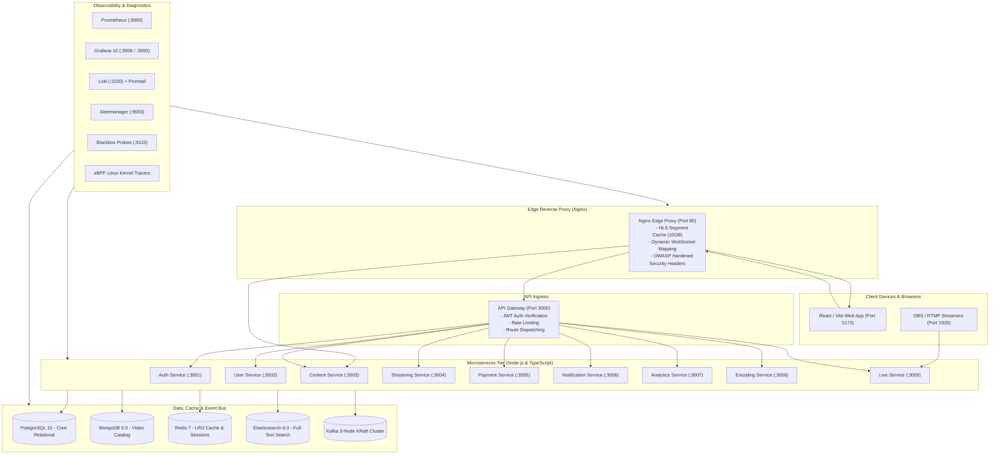

# OTT Streaming Platform — Comprehensive Feature Specification & Architecture Map

> A high-concurrency, enterprise-grade video on-demand (VOD) and live streaming platform built with a modern microservices architecture, adaptive HLS media processing pipeline, distributed event streaming, and full-stack observability.

---

## 📑 Table of Contents
1. [Architecture & Topology Overview](#1-architecture--topology-overview)
2. [Frontend Web Application (UI/UX)](#2-frontend-web-application-uiux)
3. [Backend Microservices Ecosystem](#3-backend-microservices-ecosystem)
4. [Media Processing & Transcoding Pipeline](#4-media-processing--transcoding-pipeline)
5. [Database, Caching & Event Streaming Tier](#5-database-caching--event-streaming-tier)
6. [Edge Reverse Proxy, Video CDN & Networking](#6-edge-reverse-proxy-video-cdn--networking)
7. [Security, Auth & Compliance Architecture](#7-security-auth--compliance-architecture)
8. [Observability, Monitoring & Kernel Diagnostics](#8-observability-monitoring--kernel-diagnostics)
9. [DevOps, Automation & Operational Tooling](#9-devops-automation--operational-tooling)

---

## 1. Architecture & Topology Overview



---

## 2. Frontend Web Application (UI/UX)

Built with **React 18, TypeScript, Vite, TailwindCSS / Custom Design System, and Lucide Icons**.

### 🎬 Core Consumer Pages
* **Home Page (`HomePage.tsx`)**:
  * Netflix-style hero banner with autoplay teaser and dynamic backdrop.
  * Curated carousels (Trending Now, Top Rated, Continue Watching, Recommended for You).
  * Video preview on hover with sound toggle and quick action buttons (Play, Add to List, Info).
* **Browse & Discovery Page (`BrowsePage.tsx`)**:
  * Fast catalog search powered by Elasticsearch with instant debounce filtering.
  * Multi-dimensional filtering by genre, tags, release year, duration, and resolution.
  * Interactive modal view (`NetflixModal.tsx`) with full synopsis, cast, director, and related recommendations.
* **Video Player & Streaming (`StreamModal` / Video.js)**:
  * Adaptive Bitrate Streaming (ABR) with automatic resolution switching (`1080p` $\rightarrow$ `720p` $\rightarrow$ `480p` $\rightarrow$ `360p`).
  * Custom player controls: Resolution selector, playback speed (`0.5x` to `2.0x`), volume slider, picture-in-picture, fullscreen.
  * Video resume capability: Saves playback timestamp to Redis/Postgres for "Continue Watching".
* **24/7 Live TV & EPG (`LiveTVPage.tsx`)**:
  * Live television channel guide with real-time Electronic Program Guide (EPG) grid.
  * Real-time channel switching, schedule timeline, and "Now Playing" vs "Up Next" metadata.
* **Live Broadcast Viewer (`LivePage.tsx`)**:
  * Ultra-low latency live stream playback with real-time viewer count and live stream status indicators.
  * Integrated live chatroom with message dispatching.

### 🛠️ Creator, Studio & Admin Pages
* **Video Studio & Direct Upload (`UploadPage.tsx`)**:
  * Multi-gigabyte direct line-rate file uploader bypassing intermediate API gateway hops.
  * Real-time encoding progress bar receiving live WebSocket / Kafka progress events (`0%` to `100%`).
  * Custom encoding ladder configuration (select target qualities: `1080p`, `720p`, `480p`, `360p`).
  * Custom thumbnail extraction or custom poster image upload.
  * Auto master file purge option (`AUTO_DELETE_RAW_AFTER_ENCODE`) to reclaim disk space upon completion.
* **Admin Live Studio (`AdminLiveStudioPage.tsx` / `StudioManager.tsx`)**:
  * Unique RTMP Stream Key generation and secure stream endpoint URL (`rtmp://<host>:1935/live`).
  * Real-time broadcaster health monitor: Bitrate gauge, FPS counter, dropped frames, active stream status.
* **Admin Management Console (`AdminDashboard.tsx`)**:
  * Video catalog manager: Edit metadata, change visibility (public/unlisted/private), delete content.
  * User moderation: View registered users, assign roles (Admin, Creator, User), ban/suspend accounts.
  * Real-time transcoding queue inventory and system overview metrics.
* **System Health Monitor (`SystemHealthPage.tsx`)**:
  * Live status dashboard displaying the health, response latency, and memory of all 10 backend microservices.

### 👤 User Account & Billing Pages
* **Authentication (`LoginPage.tsx`, `SignupPage.tsx`)**:
  * Email and password authentication with bcrypt validation and JWT token issuance.
  * Password strength analyzer and token refresh lifecycle management.
* **User Profile & Settings (`ProfilePage.tsx`)**:
  * Profile customization (avatar, display name, email).
  * Streaming preferences: Default playback quality, autoplay next episode, default audio/subtitle language.
  * UI Theme customizer (Dark Mode / Light Mode).
* **Subscription & Billing (`PaymentPage.tsx`)**:
  * Interactive pricing plan tiers: **Free ($0)**, **Basic ($9.99)**, **Premium ($19.99)**, and **Family ($29.99)**.
  * Stripe payment integration with subscription lifecycle (active, renewal date, cancellation reason).
* **Notifications Center (`NotificationPage.tsx`)**:
  * Real-time alert feed for completed video uploads, new channel live broadcasts, and subscription renewals.

---

## 3. Backend Microservices Ecosystem

All services are built with **Node.js, TypeScript, Express/Fastify, Docker, and KafkaJS**.

| Microservice | Internal Port | Primary Responsibilities | Data Store / Event Topics |
| :--- | :---: | :--- | :--- |
| **`api-gateway`** | `3000` | Unified API entry point, JWT verification, rate limiting, request forwarding, `/health`, `/metrics`. | Redis (Rate limiting) |
| **`auth-service`** | `3001` | User registration, login, token refresh, password hashing, session management. | PostgreSQL (`users`, `user_sessions`) |
| **`user-service`** | `3002` | User profiles, account settings, viewing preferences, role management. | PostgreSQL (`user_preferences`) |
| **`content-service`**| `3003` | Video catalog metadata, search indexation, direct video upload intake. | MongoDB (`videos`), Elasticsearch |
| **`streaming-service`**| `3004` | HLS manifest serving (`playlist.m3u8`), secure segment authorization. | Disk Volumes (`/videos/encoded`) |
| **`payment-service`** | `3005` | Stripe subscription handling, checkout sessions, invoice history, plan quotas. | PostgreSQL (`subscriptions`, `payments`) |
| **`notification-service`**| `3006` | In-app notification dispatcher, email/push alerts. | MongoDB (`notifications`), Kafka Consumer |
| **`analytics-service`**| `3007` | Video view counting, watch duration tracking, popularity ranking. | PostgreSQL, Kafka Consumer |
| **`encoding-service`** | `3008` | Automated multi-profile FFmpeg HLS transcoding, thumbnail generation, master purging. | Kafka (`video.uploaded`, `video.encoding.*`) |
| **`live-service`** | `3009` | RTMP server (port 1935), real-time live HLS stream packager (port 8000). | In-memory RAM stream buffer |

---

## 4. Media Processing & Transcoding Pipeline

Automated VOD encoding orchestrated by `encoding-service` using **FFmpeg & libx264**:

```
Raw Upload (.mp4/.mov/.mkv)
  │
  ├── 1. Probe Metadata (ffprobe: resolution, fps, audio channels, duration)
  │
  ├── 2. Smart Ladder Selection (Select profiles <= source resolution)
  │     ├── 1080p (1920x1080 @ 5000k)
  │     ├── 720p  (1280x720  @ 2500k)
  │     ├── 480p  (854x480   @ 1500k)
  │     └── 360p  (640x360   @ 800k)
  │
  ├── 3. HLS Transcoding & Alignment
  │     ├── GOP Keyframe Alignment (Fixed 2-second keyframes for seamless ABR switching)
  │     ├── Zero-CPU Audio Stream Copy (-c:a copy if source is already AAC stereo)
  │     └── Output Segments: 6-second MPEG-TS chunks (.ts)
  │
  ├── 4. Master Multivariant Manifest Generation (playlist.m3u8)
  │
  ├── 5. Automatic Fallback Thumbnail Extraction (thumbnail.jpg @ 1280x720)
  │
  ├── 6. Auto-Purge Raw Master File (Reclaims GBs of disk space upon success)
  │
  └── 7. Kafka Progress & Completion Events (Emits video.encoding.completed)
```

---

## 5. Database, Caching & Event Streaming Tier

### 🐘 PostgreSQL 15 (Relational Core)
* **Configuration**: `max_connections=500`, `shared_buffers=256MB`, `effective_cache_size=1GB`, `work_mem=16MB`.
* **Client Session Tracking**: Connected microservices pass `PGAPPNAME` (e.g. `auth-service`, `payment-service`) for real-time connection telemetry.
* **Tables**: `users`, `user_preferences`, `user_sessions`, `subscription_plans`, `subscriptions`, `payments`, `audit_logs`.
* **Automated Disaster Recovery**: Automated nightly cron backups with 7-day rolling retention in [`/backups/`](file:///home/almalinux/ott-app/backups/).

### 🍃 MongoDB 6.0 (Catalog & Documents)
* **Purpose**: High-throughput video metadata, tags, comments, and notification history.
* **Connection Pool**: `--maxConns=1000` with WiredTiger storage engine.

### ⚡ Redis 7 (In-Memory Cache & Rate Limiter)
* **Purpose**: API Gateway token caching, fast session validation, rate limiting, and video resume positions.
* **Configuration**: `maxmemory 512m`, `allkeys-lru` eviction policy.

### 🔍 Elasticsearch 8.0 (Search & Recommendation Engine)
* **Purpose**: Sub-second full-text video search, fuzzy matching, creator tagging, and trending catalog queries.

### 📨 Kafka 3-Node KRaft Cluster (Event Bus)
* **Cluster Quorum**: 3 brokers (`kafka-1`, `kafka-2`, `kafka-3`) running in KRaft mode (no ZooKeeper dependency).
* **Core Topics**:
  * `video.uploaded` — Triggers automated transcoding pipeline.
  * `video.encoding.progress` — Real-time progress updates for creator dashboard.
  * `video.encoding.completed` — Notifies content service to publish HLS stream.
  * `video.viewed` — Streaming analytics and watch-time telemetry.
  * `user.created` / `payment.succeeded` — Triggers onboarding notifications.

---

## 6. Edge Reverse Proxy, Video CDN & Networking

Configured in [`infra/nginx/nginx.conf`](file:///home/almalinux/ott-app/infra/nginx/nginx.conf) and [`infra/nginx/conf.d/ott.conf`](file:///home/almalinux/ott-app/infra/nginx/conf.d/ott.conf):

* **Edge Video Segment Micro-Cache (`proxy_cache HLS_CACHE`)**:
  * In-memory key zone (100MB) + Disk cache (10GB max) with **12-hour caching for `.ts` video chunks**.
  * Offloads origin video streaming servers by up to **90%** during peak viewer concurrency.
* **Instant Playlist Pass-Through**:
  * `.m3u8` playlist manifests bypass cache (`no-cache`) for zero-delay stream startup and live updates.
* **Direct Line-Rate Video Ingestion Route (`/api/content/upload`)**:
  * Direct 10GB streaming upload proxy to `content-service` (bypasses gateway intermediate hops).
* **Dynamic WebSocket Connection Upgrade**:
  * Dynamic `$connection_upgrade` mapping supporting live Grafana dashboards, Vite HMR, and real-time chat.
* **Real Client IP Resolution**:
  * Dynamic Docker DNS resolver (`127.0.0.11`) with upstream keep-alive and real client IP forwarding.

---

## 7. Security, Auth & Compliance Architecture

### 🛡️ Perimeter & Edge Hardening (Nginx)
* **OWASP Hardened HTTP Security Headers**:
  * `Content-Security-Policy (CSP)`: Strict script, connect, and web worker directives while permitting dynamic Grafana WebSockets (`ws:` / `wss:`) and Vite HMR.
  * `X-Frame-Options: SAMEORIGIN`: Full protection against Clickjacking attacks.
  * `X-Content-Type-Options: nosniff`: Prevents MIME-type sniffing exploits.
  * `X-XSS-Protection: 1; mode=block`: Legacy cross-site scripting filter.
  * `Referrer-Policy: strict-origin-when-cross-origin`: Protects user privacy across cross-origin requests.
  * `Permissions-Policy`: Restricts browser camera, microphone, geolocation, and USB APIs.
  * `Cross-Origin-Opener-Policy: same-origin` & `Cross-Origin-Embedder-Policy: credentialless`.
* **Internal Telemetry Lockdown**:
  * The Nginx `/stub_status` endpoint is strictly whitelisted for internal Docker networks (`127.0.0.1`, `10.0.0.0/8`, `172.16.0.0/12`, `192.168.0.0/16`) and denies all external public requests (`deny all`).

### 🔑 Identity, Authentication & API Gateway Security
* **Dual-Token JWT Architecture**:
  * **Short-Lived Access Tokens (15m)**: Used for stateless API authentication.
  * **Secure Refresh Tokens (7d)**: Stored securely for token rotation without requiring constant re-logins.
  * Passwords hashed using **bcrypt (cost factor 10)**.
* **Distributed Sliding-Window Rate Limiting**:
  * API Gateway enforces Redis-backed rate limiting on sensitive authentication routes (`/api/auth/login`, `/api/auth/register`) to stop brute-force, password guessing, and credential stuffing attacks.
* **Internal Service-to-Service Authentication**:
  * Microservices communicate internally using HMAC signed tokens via `INTERNAL_SERVICE_SECRET`, preventing unauthorized direct API calls bypassing the API Gateway.
* **Network Isolation**:
  * Segregated Docker networks (`ott-edge-net`, `ott-app-net`, `ott-data-net`). Database ports (Postgres `5432`, Mongo `27017`, Redis `6379`, Elasticsearch `9200`) are **not bound to public host ports** (`0.0.0.0`) and remain reachable only inside the internal network.

### 📊 Application Security & Threat Intelligence Monitoring
* **Dedicated Security Dashboard** (`ott-app-security`):
  * **Security Health Score Gauge (0–100)**: Real-time health calculation based on 4xx/5xx ratios and auth failure velocity.
  * **Brute-Force & Attack Tracking**:
    * **`401 Unauthorized` Rate**: Detects automated credential guessing.
    * **`403 Forbidden` Rate**: Tracks unauthorized privilege escalation attempts.
    * **`429 Rate Limit Exceeded`**: Identifies scraping and DDoS attempts.
    * **`5xx Server Error`**: Catches unhandled exceptions and vulnerability probing.
  * **Loki Security Audit Stream**:
    * Real-time log stream filtering auth failures, IP addresses, targeted endpoints, and malicious user agents.

### 🧪 Kernel-Level Security & Network Anomaly Detection (eBPF)
* **TCP Packet Drop & Network Anomaly Tracer** (`scripts/ebpf/trace-packet-drops.bt`):
  * Attaches to Linux kernel tracepoints (`kfree_skb`, `tcp_drop`, `net:net_dev_xmit`).
  * Traces intentional packet drops, socket buffer exhaustion, and network-level anomalies between microservices in real time with near-zero (< 1%) CPU overhead.

### 🔒 Secrets Management & Operational Security
* **Docker Secrets Segregation**:
  * Production secrets (DB passwords, JWT secrets, Stripe API keys) are stored in individual files (`secrets/*.txt`) and mounted as in-memory files at `/run/secrets/` rather than passed as raw plaintext environment variables.
* **Secure Container Hardening Overlay** (`docker-compose.security.yml`):
  * Restricts container privileges with `no-new-privileges: true` and drops unneeded Linux kernel capabilities.
* **Grafana Admin Security**:
  * Rotated and escaped secure admin password (`5k$forYou`).

### 🗄️ Database Access Control & Forensics
* **PostgreSQL Caller Attribution (`PGAPPNAME`)**:
  * Every microservice explicitly tags its database connection pool (`auth-service`, `user-service`, `payment-service`).
  * Allows security audits in `pg_stat_activity` to attribute every query, lock, and transaction to an exact microservice caller and database role.
* **Least-Privilege Roles**:
  * Dedicated application role `ott_user` configured with schema-scoped permissions.
* **Audit Logging Table (`audit_logs`)**:
  * Stores user actions, modified entity IDs, before/after JSON values, client IP addresses, and user agents.

### 🎬 Content Protection & DRM
* **Ephemeral Signed Stream Tokens**:
  * Streaming endpoints require HMAC-SHA256 signed playback tokens with short TTLs to prevent URL hotlinking.
* **HLS AES-128 Encryption Support**:
  * Capable of encrypting `.ts` video segments with AES-128 keys distributed through an authorized key delivery gateway.
* **Concurrent Stream Guard**:
  * Redis-backed limits on active concurrent video streams per user account based on their subscription tier.

---

## 8. Observability, Monitoring & Kernel Diagnostics

### 📈 Prometheus (22 Active Scrape Targets)
Scrapes all 10 microservices, cAdvisor, Node Exporter, PostgreSQL Exporter, Redis Exporter, Kafka Exporter, Elasticsearch Exporter, Nginx Exporter, Alertmanager, and Blackbox Probes every 10 seconds.

### 🚨 Alertmanager (17 Production Alert Rules)
Automated incident detection for:
* `ServiceDown`, `High5xxErrorRate`, `HighHttpLatencyP95`, `NodeJsEventLoopLagHigh`.
* `PostgresDown`, `PostgresHighConnections`, `RedisDown`, `RedisHighMemoryUsage`.
* `ElasticsearchClusterRed`, `KafkaBrokerDown`, `KafkaHighConsumerLag`.
* `HostDown`, `HostHighCpuLoad`, `HostLowMemory`, `HostDiskSpaceCritical`, `NginxDown`, `SyntheticProbeFailed`.

### 📊 6 Provisioned Grafana Dashboards
Accessible at `http://<host>/grafana/` (Credentials: `admin` / `5k$forYou`):
1. **`OTT Platform - Microservices Overview`**: Total RPS, p95/p99 latency, error rate, process memory.
2. **`OTT Platform - Databases, Caches & Kafka Queues`**: 
   - **Who is Executing**: Connections by service (`auth-service`, `payment-service`) and database user.
   - **What is Executing**: Real-time breakdown of `SELECT`, `INSERT`, `UPDATE`, `DELETE` rows/sec.
   - **Redis & Kafka**: Cache hit/miss ratio, memory limits, and Consumer Group Lag per topic.
3. **`OTT Platform - Edge Proxy, Synthetics & Alertmanager`**: Nginx active connections, synthetic probe latency, and active firing alerts table.
4. **`OTT Platform - Application Security & Threat Intelligence`**: 401/403/429 spikes, security audit logs stream.
5. **`OTT Platform - Business, Content & Payment Intelligence`**: Video uploads (24h), creator rankings, user growth, subscription success rate.
6. **`Containers & Host Resources (cAdvisor / Node Exporter)`**: Linux host CPU/RAM/Disk and Docker cgroup limits.

### 🧪 eBPF Kernel Tracing Suite
Zero-overhead Linux kernel observability programs located in [`scripts/ebpf/`](file:///home/almalinux/ott-app/scripts/ebpf/):
* `trace-packet-drops.bt`: Traces service-to-service TCP packet drops and socket queue overflows.
* `trace-hls-latency.bt`: Traces client TCP connection latency and HLS streaming connections.
* `trace-video-io.bt`: Traces disk block I/O latency distribution when writing video chunks.
* `trace-container-cpu.bt`: Traces on-CPU compute time vs scheduler context switches across containers.

---

## 9. DevOps, Automation & Operational Tooling

### 🚀 Fully Automated Continuous Deployment (CI/CD Pipeline)
* **GitHub Actions Automated CD (`.github/workflows/deploy.yml`)**:
  * **Trigger on Push to `main`**: Automatically deploys changed microservices to production host `180.94.20.40` via secure SSH Action.
  * **On-Demand Manual Workflow Dispatch**: Allows deploying individual services (`frontend`, `api-gateway`, `content-service`, etc.) or triggering a full platform rolling update (`all`).
* **Zero-Downtime Safe Deployment Script ([`scripts/deploy.sh`](file:///home/almalinux/ott-app/scripts/deploy.sh))**:
  * **Isolated Image Build**: Builds the target microservice Docker image in the background.
  * **In-Place Container Replacement**: Gracefully recreates the target container (`docker compose up -d --no-deps <service>`) without terminating network bridges or adjacent services.
  * **Automated Healthcheck Gate**: Polls the container's healthcheck endpoint until verified `healthy` before proceeding.
  * **Seamless Nginx Signal Reload**: Tests Nginx syntax (`nginx -t`) and issues a graceful worker reload (`nginx -s reload`) to switch upstream traffic with **0 dropped connections**.

### ☸️ Enterprise Kubernetes (K8s) Production Architecture
* **Cloud-Agnostic Modular Manifests ([`k8s/`](file:///home/almalinux/ott-app/k8s/))**:
  * Fully compatible across **AWS EKS**, **Google Cloud GKE**, **Azure AKS**, and on-premise/bare-metal **K3s / Minikube** clusters.
* **Unified Kustomize Orchestration ([`k8s/kustomization.yaml`](file:///home/almalinux/ott-app/k8s/kustomization.yaml))**:
  * One-command deployment: `kubectl apply -k k8s/` or automated rollout script [`scripts/deploy-k8s.sh`](file:///home/almalinux/ott-app/scripts/deploy-k8s.sh).
* **High Availability & Auto-Scaling (HPA)**:
  * Horizontal Pod Autoscaling configured for `api-gateway` (2-10 replicas), `streaming-service` (2-10 replicas), and `frontend` (2-8 replicas) based on CPU/RAM utilization targets.
* **Resilient Multi-Node Event Streaming**:
  * 3-replica ZooKeeper-less Kafka KRaft cluster orchestrated via StatefulSet (`kafka-0`, `kafka-1`, `kafka-2`) with headless network peering.
* **High-Throughput Shared Storage (RWX)**:
  * Multi-attach persistent storage claim (`videos-data-pvc`) mounted across transcoding, content, live ingestion, and video delivery pods.
* **Unified Ingress & WebSocket Routing ([`k8s/07-ingress/ingress.yaml`](file:///home/almalinux/ott-app/k8s/07-ingress/ingress.yaml))**:
  * Nginx Ingress routing for `/`, `/api/`, `/hls/`, and `/grafana/` supporting up to 10GB video file uploads, chunk caching, and WebSocket connections.

### ⚙️ Cluster Initialization & Infrastructure Automation
* **Automated Database Provisioning ([`scripts/init-databases.sh`](file:///home/almalinux/ott-app/scripts/init-databases.sh))**:
  * Automatically creates extensions (`uuid-ossp`, `pgcrypto`), applies database schemas, sets up least-privilege roles (`ott_user`), and seeds default subscription tiers.
* **Automated Kafka Topic Provisioning ([`scripts/kafka-init.sh`](file:///home/almalinux/ott-app/scripts/kafka-init.sh))**:
  * Automatically provisions partitioned Kafka topics (`video.uploaded`, `video.encoding.*`, `video.viewed`) upon cluster startup.
* **Automated Cron Jobs & Maintenance ([`scripts/setup-cron.sh`](file:///home/almalinux/ott-app/scripts/setup-cron.sh))**:
  * Nightly automated database backups at 03:00 with 7-day rolling retention.
  * Automated garbage collection for orphaned raw uploads and temporary transcode chunks.

### 🎛️ Operational Modes & Testing
* **Mode Management ([`scripts/set-mode.sh`](file:///home/almalinux/ott-app/scripts/set-mode.sh))**:
  * `./scripts/set-mode.sh prod` — Applies strict production CPU/RAM cgroups and security hardening.
  * `./scripts/set-mode.sh debug` — Exposes all microservice internal ports for local debugging.
  * `./scripts/set-mode.sh unconstrained` — Removes CPU/RAM throttles for heavy stress-testing.
* **Database Disaster Recovery**:
  * [`scripts/backup.sh`](file:///home/almalinux/ott-app/scripts/backup.sh) — Automated full backups for PostgreSQL and MongoDB.
  * [`scripts/restore.sh`](file:///home/almalinux/ott-app/scripts/restore.sh) — Point-in-time database restoration script.
* **Storage Maintenance**:
  * [`scripts/cleanup-orphaned-videos.sh`](file:///home/almalinux/ott-app/scripts/cleanup-orphaned-videos.sh) — Cleans up abandoned raw uploads and unlinked video segments.
* **Load & Performance Benchmarking**:
  * [`k6-stress.js`](file:///home/almalinux/ott-app/k6-stress.js) & [`scripts/benchmark.js`](file:///home/almalinux/ott-app/scripts/benchmark.js) — High-concurrency stress test suite for video streaming endpoints.

---

### 🌐 Quick Access URLs & Credentials

| Service | Public / Internal URL | Default Credentials |
| :--- | :--- | :--- |
| **Frontend Web App** | `http://180.94.20.40/` (or `http://localhost/`) | Public / User Login |
| **Grafana Observability** | `http://180.94.20.40/grafana/` | `admin` / `5k$forYou` |
| **API Gateway Ingress** | `http://180.94.20.40/api/` | Bearer JWT Token |
| **Prometheus Metrics** | `http://localhost:9090` | Internal / No Auth |
| **Alertmanager UI** | `http://localhost:9093` | Internal / No Auth |
| **RTMP Ingestion** | `rtmp://180.94.20.40:1935/live/<key>` | Broadcaster Stream Key |
