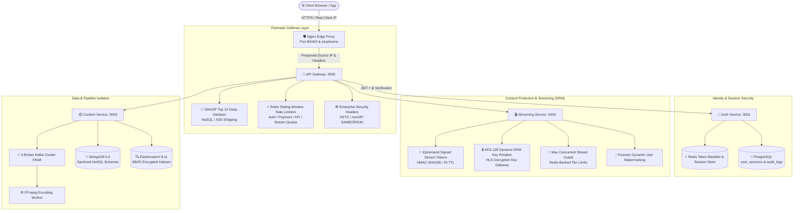

# 🛡️ OTT Platform - Enterprise Security Architecture & Implementation Guide

This document provides a comprehensive technical reference for all security mechanisms, defenses, cryptographic standards, and forensic auditing features implemented across the OTT Platform.

---

## 📑 Table of Contents
1. [Security Architecture Overview](#1-security-architecture-overview)
2. [Edge & Perimeter Hardening](#2-edge--perimeter-hardening)
3. [API Gateway & Defense-in-Depth](#3-api-gateway--defense-in-depth)
4. [Authentication & Multi-Device Session Guard](#4-authentication--multi-device-session-guard)
5. [Security Audit Logs & Admin Forensics Engine](#5-security-audit-logs--admin-forensics-engine)
6. [DRM, Content Protection & Anti-Piracy](#6-drm-content-protection--anti-piracy)
7. [Database & Data Persistence Security](#7-database--data-persistence-security)
8. [Media Ingestion & Pipeline Security](#8-media-ingestion--pipeline-security)
9. [Operational Security (SecOps) & Incident Response](#9-operational-security-secops--incident-response)

---

## 1. Security Architecture Overview

The platform implements a **Defense-in-Depth (Zero-Trust)** security posture spanning from edge reverse proxies down to the database and asynchronous Kafka transcoding workers.



---

## 2. Edge & Perimeter Hardening

### 2.1 True Source IP Preservation (Rootless Docker + Nginx)
In production container environments (Rootless Docker with RootlessKit), source IPs can easily be masked by Docker NAT (`172.18.0.1`).
- **Slirp4netns Port Driver**: Configured `DOCKERD_ROOTLESS_ROOTLESSKIT_PORT_DRIVER=slirp4netns` in systemd daemon overrides, ensuring true remote client IPs are preserved across the TCP socket.
- **Nginx Real-IP Directives** (`infra/nginx/nginx.conf`):
  ```nginx
  set_real_ip_from 127.0.0.1;
  set_real_ip_from 10.0.0.0/8;
  set_real_ip_from 172.16.0.0/12;
  set_real_ip_from 192.168.0.0/16;
  real_ip_header X-Forwarded-For;
  real_ip_recursive on;
  ```
- **Gateway Forwarding**: Custom decorator in API Gateway normalizes IP strings, cleanly stripping IPv6 compatibility prefixes (`::ffff:`) before forwarding `X-Real-IP`, `X-Client-IP`, and `X-Forwarded-For` to microservices.

### 2.2 Enterprise Security Headers
Every HTTP response emitted by the edge proxy and API Gateway enforces standard security headers:
- `Strict-Transport-Security: max-age=15552000; includeSubDomains; preload`
- `X-Content-Type-Options: nosniff` (prevents MIME-type sniffing attacks)
- `X-Frame-Options: SAMEORIGIN` (mitigates clickjacking in iframes)
- `X-XSS-Protection: 1; mode=block`
- `Referrer-Policy: no-referrer-when-downgrade`
- `X-Download-Options: noopen` (prevents IE from executing direct downloads)

---

## 3. API Gateway & Defense-in-Depth

### 3.1 Deep Recursive OWASP Top 10 Sanitizer
Located at [`sanitizer.middleware.ts`](file:///home/almalinux/ott-app/services/api-gateway/src/middleware/sanitizer.middleware.ts):
- **NoSQL Injection Prevention**: Recursively inspects all request bodies, query strings, and URL parameters, neutralizing dangerous MongoDB operators (`$gt`, `$ne`, `$where`, `$regex`, `$or`, `.`) and stripping prohibited prefixes.
- **Cross-Site Scripting (XSS) Prevention**: Sanitizes malicious HTML script blocks (`<script>`, `<iframe>`, `onload=`, `onerror=`, `javascript:` URI schemes) from all incoming payloads.

### 3.2 Redis Sliding-Window Rate Limiters
Located at [`rate-limit.middleware.ts`](file:///home/almalinux/ott-app/services/api-gateway/src/middleware/rate-limit.middleware.ts):
Implemented with distributed atomic Redis sliding counters, returning `429 Too Many Requests` with standard `RateLimit-*` and `Retry-After` headers when quotas are exceeded:

| Scope | Path Prefix | Window | Limit | Purpose |
|---|---|---|---|---|
| **Auth Limiter** | `/api/auth/login`, `/register`, `/password-reset` | 60s | **10 req/min** | Mitigates brute-force & credential stuffing |
| **Payment Limiter** | `/api/payment/*` | 60s | **15 req/min** | Prevents card testing & payment race conditions |
| **Standard API** | `/api/*` | 60s | **300 req/min** | General DoS & API scraping defense |
| **Streaming Limiter** | `/api/stream/*`, `/api/content/hls/*` | 60s | **2,000 req/min** | High-throughput HLS chunk delivery |

### 3.3 Inter-Service Internal Secret Guard
All internal microservice endpoints (`/metrics`, `/health`, inter-service RPC) check for a cryptographically secure `x-internal-service-secret` header matching `INTERNAL_SERVICE_SECRET`. Direct requests bypassing the API Gateway are rejected with `403 Forbidden`.

---

## 4. Authentication & Multi-Device Session Guard

### 4.1 Cryptographic JWT Tokens with Unique JTI
- Standard HMAC-SHA256 tokens signed with `JWT_SECRET`.
- Every generated access token includes a unique `jti` (JWT ID UUIDv4) in its payload:
  ```json
  {
    "userId": "2f2134f2-0584-42ec-a456-3c9ed6147533",
    "email": "admin@example.com",
    "role": "admin",
    "subscriptionTier": "vip",
    "jti": "8e3c12f4-a951-46bb-8201-c81920ef11b4",
    "exp": 1788182400
  }
  ```

### 4.2 Multi-Device Session Tracking & Instant Revocation
Located in [`services/auth-service/src/services/session.service.ts`](file:///home/almalinux/ott-app/services/auth-service/src/services/session.service.ts):
- Every successful login creates a persistent session record in PostgreSQL `user_sessions`:
  - `session_id`, `user_id`, `token_jti`
  - Parsed User-Agent (Browser, OS, Device Type)
  - True Remote IP Address with classification (`Public Network` vs `Local Network`)
  - `is_active`, `last_active_at`, `created_at`, `expires_at`
- **1-Click Remote Device Logout**: Users can view all active logged-in devices in their **Profile > Active Devices & Sessions** tab and remotely revoke any single session or click **"Sign Out All Other Devices"**.
- **Real-Time Redis Token Blacklist**: When a session is revoked, its `jti` is immediately pushed to Redis (`blacklist:${jti}`) with an expiration matching the token's remaining TTL. The API Gateway verifies token validity against Redis on every authenticated request in `<1ms`.

### 4.3 Role-Based Access Control (RBAC) & Subscription Tiers
- **User Roles**: `user` (default viewer), `admin` (studio media manager), `superadmin` (full system governance).
- **Subscription Tiers**: `free`, `basic`, `premium`, `vip`.
- Gateway middleware and service controllers validate both role and tier entitlements before granting access to premium 4K streams, administrative APIs, and metrics.

---

## 5. Security Audit Logs & Admin Forensics Engine

### 5.1 Immutable Audit Event Logging
Located in [`services/auth-service/src/services/audit.service.ts`](file:///home/almalinux/ott-app/services/auth-service/src/services/audit.service.ts):
Every critical security event is recorded in the PostgreSQL `audit_logs` table with full forensic context:
- **Captured Events**: `LOGIN_SUCCESS`, `LOGIN_FAILED`, `LOGOUT`, `PASSWORD_CHANGE`, `SESSION_REVOKED`, `ALL_SESSIONS_REVOKED`, `TIER_UPGRADED`, `BRUTE_FORCE_ATTEMPT`, `SUSPICIOUS_IP`.
- **Metadata Logged**: Event Type, Target User ID, Actor Email, Client IP, User-Agent, Request Path, Request Method, Timestamp, Calculated Risk Level, and JSON Details.

### 5.2 Dynamic Threat Risk Scoring
The audit engine calculates a real-time risk level for every event based on failure frequency, anomalous user agents, and IP patterns:
- 🟢 **LOW**: Normal authenticated operations (`LOGIN_SUCCESS`, `LOGOUT`).
- 🟡 **MEDIUM**: User state changes (`SESSION_REVOKED`, `PASSWORD_CHANGE`).
- 🟠 **HIGH**: Authentication failures (`LOGIN_FAILED`), rapid consecutive attempts.
- 🔴 **CRITICAL**: Credential brute-forcing, blacklisted token replay, unauthorized admin escalation attempts.

### 5.3 Admin Security Forensics Dashboard
Accessible under **Admin Console > Security Audit Logs & Forensics**:
- **Real-Time Threat Metric Cards**: Displays total logged events, high-risk security triggers, failed logins, and active concurrent sessions.
- **Forensic Inspector Modal**: Click any log to inspect deep JSON forensic payloads, device signatures, and IP origins.
- **Filter & Search Engine**: Filter by risk level (`LOW`, `MEDIUM`, `HIGH`, `CRITICAL`), event type, or actor email/IP.
- **1-Click Forensic CSV Export**: Download the complete, tamper-proof audit trail for regulatory compliance (GDPR, SOC2, ISO 27001).

---

## 6. DRM, Content Protection & Anti-Piracy

### 6.1 Ephemeral Signed Playback Tokens
Located in [`services/streaming-service/src/controllers/streaming.controller.ts`](file:///home/almalinux/ott-app/services/streaming-service/src/controllers/streaming.controller.ts):
- Playback requires generating an ephemeral HMAC-SHA256 stream token via `/api/stream/:videoId/token`.
- Tokens are bound to the specific `videoId`, `userId`, client IP, and an expiration timestamp (2 hours).
- Accessing HLS manifests (`/api/content/videos/:videoId/hls`) or media chunks without a valid token is rejected with `403 Forbidden`.

### 6.2 AES-128 Dynamic HLS Encryption & DRM Key Gateway
- Video transcoding profiles (1080p, 720p, 480p, 360p) are encrypted chunk-by-chunk using AES-128 standard encryption.
- The HLS master playlist points to the secure DRM Key endpoint:
  ```m3u8
  #EXT-X-KEY:METHOD=AES-128,URI="/api/stream/drm-key?videoId=...&token=...",IV=0x...
  ```
- The DRM Key Gateway checks the user's active session, stream token signature, and subscription tier before serving the binary 16-byte decryption key.

### 6.3 Max Concurrent Stream Guard (Anti-Account Sharing)
- Prevents account sharing across multiple concurrent screens.
- Active stream sessions are registered in Redis (`active_streams:${userId}:${sessionId}`).
- Concurrency limits enforced by subscription tier:
  - **Basic**: 1 concurrent stream
  - **Standard / Premium**: 2 concurrent streams
  - **VIP 4K**: Up to 4 concurrent streams
- Exceeding the account limit rejects subsequent stream initialization with `429 Too Many Streams Active`.

### 6.4 Forensic Dynamic Video Watermarking
- The 4K Video Player embeds a semi-transparent, dynamic forensic watermark overlay across the player canvas during playback.
- The watermark displays the authenticated `userId`, timestamp, and stream session ID, deterring screen recording and enabling traceability in case of content leakage.

---

## 7. Database & Data Persistence Security

### 7.1 PostgreSQL (Relational & Audit Data)
- **100% Parameterized Prepared Statements**: Strictly eliminates SQL injection across all authentication, user management, session tracking, and payment controllers.
- **Connection Isolation**: Configured with dedicated database users (`ott_user`), connection pooling, and restricted schema privileges.

### 7.2 MongoDB (Catalog, Watchlists & Notifications)
- **Strict Schema Enforcement**: Mongoose models validate all input types, required constraints, and data lengths.
- **Sanitized NoSQL Queries**: Query filters reject nested objects and operator injection ($gt, $ne, $where) enforced by gateway and service sanitizers.

### 7.3 Redis (Session Cache, Token Blacklist & Rate Limiters)
- **Password Authentication**: Secured with high-entropy password (`IJQWO2DBGY3QU`).
- **Namespace Isolation**: Structured key namespaces (`blacklist:*`, `ratelimit:*`, `active_streams:*`, `cache:*`).
- **TTL Expiration**: All temporary state, blacklist tokens, and rate limit counters have strict TTLs to prevent memory exhaustion.

---

## 8. Media Ingestion & Pipeline Security

### 8.1 Resumable Chunked Multipart Ingestion
Located in [`services/content-service/src/controllers/content.controller.ts`](file:///home/almalinux/ott-app/services/content-service/src/controllers/content.controller.ts):
- **Integrity Validation**: Each 10MB chunk is validated with MD5/SHA-256 checksums before merging.
- **Extension & MIME-Type Whitelist**: Rejects non-video binaries (accepts strictly `video/mp4`, `video/mkv`, `video/quicktime`, `video/webm`).
- **Path Traversal Prevention**: Absolute path resolution (`path.resolve`) enforces that all chunk uploads and video storage directories remain confined within `/tmp/ott-uploads` and `/videos/encoded`.

### 8.2 Asynchronous Worker Isolation
- Video transcoding tasks are dispatched via Kafka KRaft message queues (`video.uploaded`, `video.transcode`).
- Dedicated FFmpeg worker processes execute in isolated Docker containers with no public ingress ports, communicating strictly via internal broker topics.

---

## 9. Operational Security (SecOps) & Incident Response

### 9.1 Emergency Incident Response Runbook

#### A. Revoking a Compromised User Account
To instantly invalidate all active sessions and blacklist tokens for a compromised user:
```bash
# Via API Gateway (Admin Bearer Token required)
curl -X DELETE http://localhost/api/auth/admin/users/<USER_ID>/sessions \
  -H "Authorization: Bearer <ADMIN_TOKEN>"
```

#### B. Blocking a Malicious Remote IP
To block an aggressive IP address at the Nginx edge proxy:
```bash
# Add deny rule to infra/nginx/nginx.conf
# deny 198.51.100.23;
docker exec ott-app-nginx-1 nginx -s reload
```

#### C. Exporting Security Forensics for Investigation
```bash
# Download tamper-proof CSV audit trail for the last 24 hours
curl -X GET "http://localhost/api/auth/admin/audit-logs/export?format=csv" \
  -H "Authorization: Bearer <ADMIN_TOKEN>" -o security_forensics_$(date +%F).csv
```

### 9.2 Cryptographic Key & Secret Rotation Matrix

| Secret / Key | Environment Variable | Location | Recommended Rotation Frequency |
|---|---|---|---|
| **JWT Access Secret** | `JWT_SECRET` | `services/auth-service/.env`, `api-gateway/.env` | 90 Days |
| **Stream Token Secret** | `STREAM_SIGNING_KEY` | `services/streaming-service/.env` | 90 Days |
| **AES-128 DRM Master Key** | `DRM_MASTER_SECRET` | `services/streaming-service/.env` | 60 Days |
| **Internal Service Secret** | `INTERNAL_SERVICE_SECRET`| All `.env` files | 180 Days |
| **Redis Password** | `REDIS_PASSWORD` | `.env`, `docker-compose.yml` | 180 Days |
| **PostgreSQL Database Password**| `DB_PASSWORD` | `.env`, `docker-compose.yml` | 180 Days |

---

*Enterprise Security Specification — OTT Platform Production Environment.*
