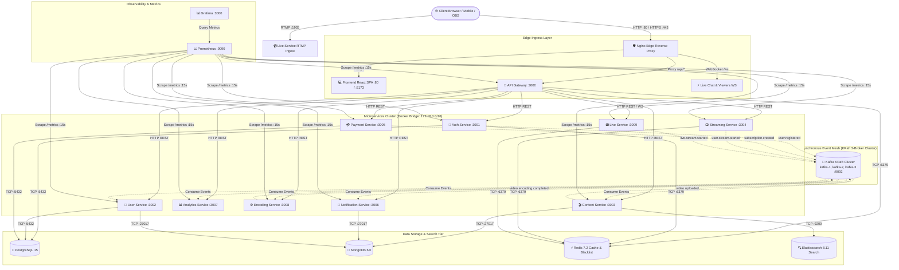
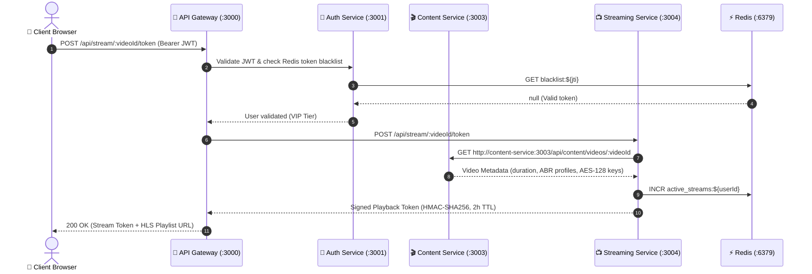
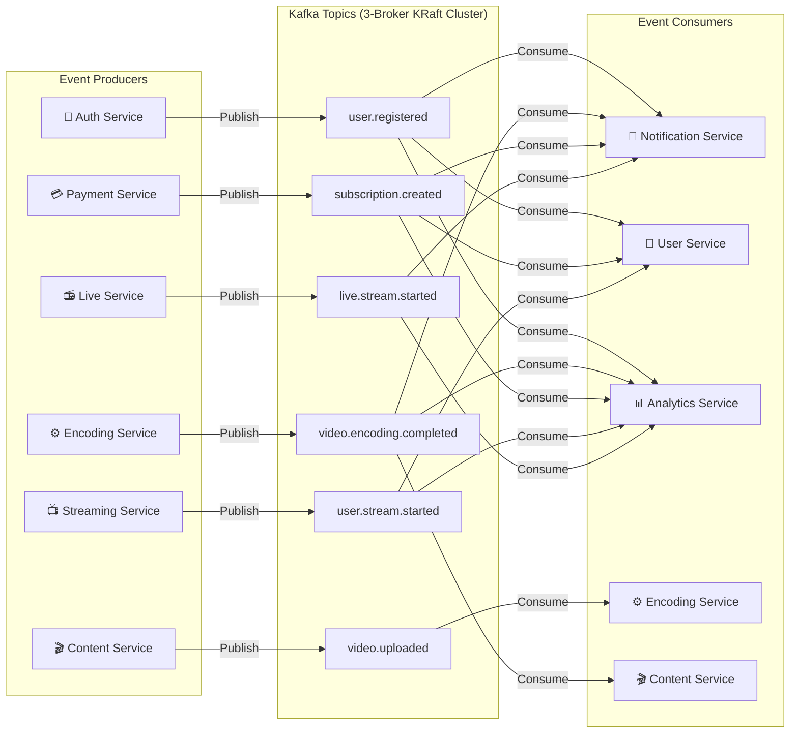
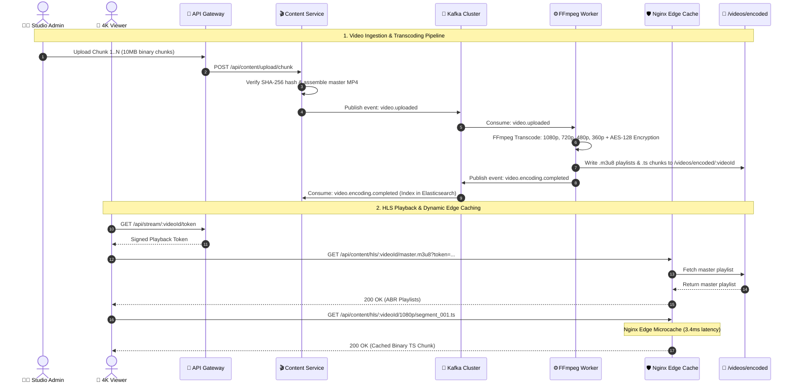

# 🌐 OTT Platform - Service-to-Service Traffic & Communication Architecture

This document provides a comprehensive technical reference for all **network traffic, communication protocols, synchronous REST RPCs, asynchronous Kafka event streaming, database topologies, and telemetry scrape paths** across the OTT platform.

---

## 📑 Table of Contents
1. [Global Network Topology & Architecture Diagram](#1-global-network-topology--architecture-diagram)
2. [Port Matrix & Service Registry](#2-port-matrix--service-registry)
3. [Ingress & API Gateway Routing Traffic](#3-ingress--api-gateway-routing-traffic)
4. [Synchronous Microservice REST & RPC Traffic](#4-synchronous-microservice-rest--rpc-traffic)
5. [Asynchronous Kafka KRaft Event Streaming](#5-asynchronous-kafka-kraft-event-streaming)
6. [Database & Data Store Traffic Matrix](#6-database--data-store-traffic-matrix)
7. [Media, Video Ingestion & Streaming Flow](#7-media-video-ingestion--streaming-flow)
8. [Observability, Prometheus Scraping & Telemetry](#8-observability-prometheus-scraping--telemetry)
9. [Inter-Service Security & Network Isolation](#9-inter-service-security--network-isolation)

---

## 1. Global Network Topology & Architecture Diagram



---

## 2. Port Matrix & Service Registry

All internal microservices run in isolated containers connected via the default Docker bridge network (`172.18.0.0/16`).

| Service Name | Container Name | Internal Port | External Port | Protocol | Primary Responsibilities |
|---|---|---|---|---|---|
| **Nginx Edge** | `ott-app-nginx-1` | 80, 443, 1935 | **80, 443, 1935** | HTTP / RTMP | Edge proxy, SSL termination, real IP preservation, RTMP ingest |
| **Frontend** | `ott-app-frontend-1` | 80 | - | HTTP | React 18 SPA production bundle |
| **API Gateway** | `ott-app-api-gateway-1` | 3000 | 3000 (Internal) | HTTP / WS | Perimeter security, JWT verification, rate limiting, request proxy |
| **Auth Service** | `ott-app-auth-service-1` | 3001 | - | HTTP | Authentication, multi-device sessions, RBAC, audit forensics |
| **User Service** | `ott-app-user-service-1` | 3002 | - | HTTP | User profiles, playlists, watch history, preferences |
| **Content Service** | `ott-app-content-service-1` | 3003 | - | HTTP | 4K video catalog, chunked uploads, Elasticsearch sync |
| **Streaming Service** | `ott-app-streaming-service-1` | 3004 | - | HTTP | HLS adaptive streaming, DRM token gate, concurrency guard |
| **Payment Service** | `ott-app-payment-service-1` | 3005 | - | HTTP | Stripe subscription webhooks, billing ledger, invoices |
| **Notification Service**| `ott-app-notification-service-1`| 3006 | - | HTTP | In-app inbox, transactional email/SMS, real-time alerts |
| **Analytics Service** | `ott-app-analytics-service-1` | 3007 | - | HTTP | Real-time video telemetry, QoS buffer tracking, user stats |
| **Encoding Service** | `ott-app-encoding-service-1` | 3008 | - | HTTP | Distributed FFmpeg 4-profile HLS ABR worker |
| **Live Service** | `ott-app-live-service-1` | 3009, 1935 | **1935** (via Nginx)| HTTP / RTMP / WS | Live broadcasting, RTMP-to-HLS pipeline, live chat WebSocket |
| **PostgreSQL 15** | `ott-app-postgres-1` | 5432 | 5432 (Internal) | TCP | Relational DB: users, sessions, audit logs, subscriptions |
| **MongoDB 6.0** | `ott-app-mongodb-1` | 27017 | 27017 (Internal)| TCP | Document DB: video catalog, notifications, watch history |
| **Redis 7.2** | `ott-app-redis-1` | 6379 | 6379 (Internal) | TCP | Token blacklist, sliding rate limits, active stream tracker |
| **Elasticsearch 8** | `ott-app-elasticsearch-1` | 9200 | - | HTTP / TCP | Full-text video catalog BM25 search engine |
| **Kafka Broker 1** | `ott-app-kafka-1-1` | 9092, 9094 | 9094 (Debug) | TCP | KRaft Controller & Event Streaming Node 1 |
| **Kafka Broker 2** | `ott-app-kafka-2-1` | 9092, 9094 | - | TCP | KRaft Controller & Event Streaming Node 2 |
| **Kafka Broker 3** | `ott-app-kafka-3-1` | 9092, 9094 | - | TCP | KRaft Controller & Event Streaming Node 3 |
| **Prometheus** | `ott-app-prometheus-1` | 9090 | 9090 (Admin) | HTTP | Time-series metrics aggregation & alerting |
| **Grafana** | `ott-app-grafana-1` | 3000 | 3000 (Internal) | HTTP | Observability metrics dashboard |

---

## 3. Ingress & API Gateway Routing Traffic

### 3.1 Ingress Routing Table
The **API Gateway** acts as the single point of entry for all microservice requests:

```
                      ┌───────────────────────────────────────────────┐
                      │             Incoming Request /api/*           │
                      └──────────────────────┬────────────────────────┘
                                             │
                       [ OWASP Deep Sanitizer & Rate Limiters ]
                                             │
                                 [ JWT & Blacklist Check ]
                                             │
     ┌──────────────┬──────────────┬─────────┴────┬──────────────┬──────────────┬──────────────┐
     ▼              ▼              ▼              ▼              ▼              ▼              ▼
/api/auth/*    /api/users/*   /api/content/*  /api/stream/*  /api/payments/* /api/notif/*  /api/live/*
     │              │              │              │              │              │              │
     ▼              ▼              ▼              ▼              ▼              ▼              ▼
:3001 (Auth)   :3002 (User)  :3003 (Content) :3004 (Stream) :3005 (Payment) :3006 (Notif) :3009 (Live)
```

| Ingress Route | Target Downstream URL | Auth Required | Rate Limit Quota | Description |
|---|---|---|---|---|
| `/api/auth/login` | `http://auth-service:3001/api/auth/login` | No | 10 req/min | Authentication & JWT issue |
| `/api/auth/register` | `http://auth-service:3001/api/auth/register` | No | 10 req/min | New user registration |
| `/api/auth/sessions` | `http://auth-service:3001/api/auth/sessions` | Yes (Bearer) | 300 req/min | Active device session listing & revocation |
| `/api/auth/admin/*` | `http://auth-service:3001/api/auth/admin/*` | Yes (Admin) | 300 req/min | Admin user management & security audit forensics |
| `/api/users/*` | `http://user-service:3002/api/users/*` | Yes (Bearer) | 300 req/min | User profile, playlists, watch history |
| `/api/content/videos` | `http://content-service:3003/api/content/videos` | No / Yes | 300 req/min | Video catalog listing & management |
| `/api/content/search` | `http://content-service:3003/api/content/search` | No | 300 req/min | Elasticsearch full-text BM25 catalog search |
| `/api/content/upload` | `http://content-service:3003/api/content/upload` | Yes (Admin) | 100 req/min | Resumable chunked video upload pipeline |
| `/api/content/hls/*` | `http://content-service:3003/api/content/hls/*` | No | 2,000 req/min | HLS multi-bitrate playlist & TS chunk delivery |
| `/api/stream/:id/token`| `http://streaming-service:3004/api/stream/:id/token` | Yes (Bearer) | 2,000 req/min | DRM signed playback token issue |
| `/api/stream/drm-key` | `http://streaming-service:3004/api/stream/drm-key` | Yes (Token) | 2,000 req/min | AES-128 binary DRM key delivery |
| `/api/payments/*` | `http://payment-service:3005/api/payments/*` | Yes (Bearer) | 15 req/min | Stripe checkout, subscription lifecycle |
| `/api/notifications/*`| `http://notification-service:3006/api/notifications/*`| Yes (Bearer) | 300 req/min | User notification inbox & preferences |
| `/api/analytics/*` | `http://analytics-service:3007/api/analytics/*` | Yes (Bearer) | 300 req/min | User QoS, buffering, playback telemetry |
| `/api/encoding/*` | `http://encoding-service:3008/api/encoding/*` | Yes (Admin) | 300 req/min | Transcoding status, progress, queue inspector |
| `/api/live/*` | `http://live-service:3009/api/live/*` | No / Yes | 2,000 req/min | Live TV channels, RTMP stream keys, WebRTC |

### 3.2 Gateway Standard Headers Forwarded to Microservices
Every proxied request carries standardized headers enriched by the API Gateway:
- `x-user-id`: Authenticated user UUID extracted from valid JWT.
- `x-user-role`: Role entitlement (`user`, `admin`, `superadmin`).
- `x-user-tier`: Subscription entitlement (`free`, `basic`, `premium`, `vip`).
- `x-request-id`: Unique distributed tracing correlation ID (`1788...-xxxx`).
- `x-internal-service-secret`: Shared inter-service secret verifying Gateway origin.
- `x-real-ip` / `x-client-ip`: Preserved remote public IP of the end client.

---

## 4. Synchronous Microservice REST & RPC Traffic

Direct synchronous HTTP communication between microservices is used for immediate operations:



### Microservice-to-Microservice Direct REST Calls

| Origin Service | Target Service | Endpoint | Protocol | Purpose |
|---|---|---|---|---|
| **API Gateway** | `auth-service` | `GET /health`, `POST /api/auth/verify` | HTTP | Service health probing & token validation |
| **Streaming Service** | `content-service` | `GET /api/content/videos/:videoId` | HTTP | Retrieve video metadata, duration & DRM keys |
| **Content Service** | `encoding-service`| `POST /api/encoding/transcode` | HTTP | Trigger on-demand FFmpeg transcoding |
| **Live Service** | `content-service` | `POST /api/content/videos` | HTTP | Automatically register completed live stream VODs |
| **Payment Service** | `auth-service` | `PUT /api/auth/users/:userId/tier` | HTTP | Instant user subscription tier synchronization |

---

## 5. Asynchronous Kafka KRaft Event Streaming

The platform utilizes a high-throughput, 3-broker **Apache Kafka (KRaft)** cluster for resilient, non-blocking asynchronous event distribution.



### Complete Kafka Topic & Event Schema Catalog

| Kafka Topic | Producer Service | Consumer Services | Payload Schema Key Fields | Business Outcome |
|---|---|---|---|---|
| `user.registered` | `auth-service` | `notification-service`, `user-service`, `analytics-service` | `userId`, `email`, `role`, `tier`, `createdAt` | Dispatches welcome notification, initializes user profile & analytics record |
| `user.profile.updated` | `user-service` | `analytics-service` | `userId`, `updatedFields`, `timestamp` | Tracks user metadata alterations |
| `user.deleted` | `auth-service` | `user-service`, `notification-service`, `streaming-service` | `userId`, `deletedAt` | Cascades deletion across sessions, watch history, and active streams |
| `subscription.created` | `payment-service`| `notification-service`, `user-service`, `analytics-service` | `subscriptionId`, `userId`, `tier`, `amount`, `expiresAt` | Upgrades user tier to VIP/Premium, logs billing transaction, sends invoice alert |
| `subscription.cancelled`| `payment-service`| `notification-service`, `user-service`, `analytics-service` | `subscriptionId`, `userId`, `effectiveDate` | Downgrades account privileges upon billing cycle expiration |
| `video.uploaded` | `content-service`| `encoding-service` | `videoId`, `rawFilePath`, `title`, `duration`, `profiles` | Dispatches raw video to FFmpeg worker queue for 4-profile ABR transcoding |
| `video.encoding.progress`| `encoding-service`| `content-service`, `analytics-service` | `videoId`, `percent` (0-100), `speed`, `currentProfile` | Updates real-time transcoding progress percentage in MongoDB & UI |
| `video.encoding.completed`| `encoding-service`| `content-service`, `notification-service`, `analytics-service`| `videoId`, `hlsManifestUrl`, `profiles`, `thumbnailUrl` | Marks video `status: ready`, generates thumbnails, indexes in Elasticsearch |
| `video.encoding.failed` | `encoding-service`| `content-service`, `notification-service` | `videoId`, `errorReason`, `timestamp` | Sets video status to `failed`, dispatches failure alert to admin |
| `video.comment.added` | `content-service`| `notification-service`, `analytics-service` | `videoId`, `commentId`, `userId`, `text` | Sends notification to content creator, records community engagement |
| `video.rated` | `content-service`| `analytics-service` | `videoId`, `userId`, `rating` (1-5), `score` | Recalculates average IMDb rating and feeds recommendation algorithms |
| `user.stream.started` | `streaming-service`| `analytics-service`, `user-service` | `userId`, `videoId`, `streamId`, `ip`, `quality`, `bitrate` | Logs QoS playback start, enforces concurrent stream caps |
| `user.stream.ended` | `streaming-service`| `analytics-service`, `user-service` | `userId`, `videoId`, `streamId`, `watchDuration`, `percentWatched`| Updates **Continue Watching** progress in MongoDB & decrements active streams |
| `live.stream.started` | `live-service` | `notification-service`, `analytics-service` | `channelId`, `title`, `streamKey`, `startedAt` | Broadcasts "Creator is Live" push alert to subscribers |
| `live.stream.ended` | `live-service` | `notification-service`, `analytics-service`, `content-service`| `channelId`, `totalViewers`, `peakViewers`, `duration` | Finalizes live metrics and queues live stream archive for VOD catalog |

---

## 6. Database & Data Store Traffic Matrix

Each persistent storage technology serves specialized data isolation and throughput requirements:

```
                           ┌────────────────────────────────────────────────────────┐
                           │               Microservice Layer                       │
                           └───────┬────────────┬────────────┬────────────┬─────────┘
                                   │            │            │            │
             ┌─────────────────────┘            │            │            └─────────────────────┐
             ▼                                  ▼            ▼                                  ▼
┌──────────────────────────┐       ┌────────────────────────┐  ┌─────────────────────────┐  ┌──────────────────────────┐
│   🐘 PostgreSQL 15       │       │    🍃 MongoDB 6.0      │  │     ⚡ Redis 7.2         │  │  🔍 Elasticsearch 8.11   │
│   Port: 5432             │       │    Port: 27017         │  │     Port: 6379          │  │  Port: 9200              │
│   Protocol: TCP          │       │    Protocol: TCP       │  │     Protocol: TCP       │  │  Protocol: HTTP / JSON   │
├──────────────────────────┤       ├────────────────────────┤  ├─────────────────────────┤  ├──────────────────────────┤
│ • users                  │       │ • videos               │  │ • blacklist:${jti}      │  │ • videos index (BM25)    │
│ • user_sessions          │       │ • categories           │  │ • ratelimit:${scope}    │  │ • title, description     │
│ • audit_logs (Forensics) │       │ • comments             │  │ • active_streams:${uid} │  │ • category, tags, cast   │
│ • subscriptions          │       │ • notifications        │  │ • live_viewers:${chan}  │  │ • imdbRating, duration   │
│ • payment_transactions   │       │ • watch_history        │  │ • cache:catalog:*       │  │                          │
│ • invoices               │       │ • continue_watching    │  │                         │  │                          │
└──────────────────────────┘       └────────────────────────┘  └─────────────────────────┘  └──────────────────────────┘
```

| Microservice | PostgreSQL (`5432`) | MongoDB (`27017`) | Redis (`6379`) | Elasticsearch (`9200`) |
|---|---|---|---|---|
| **API Gateway** | - | - | Token blacklist, Rate limits | - |
| **Auth Service** | Read/Write (`users`, `user_sessions`, `audit_logs`) | - | Token blacklist revoke | - |
| **User Service** | Read/Write (`user_profiles`) | Read/Write (`watch_history`, `continue_watching`) | User session cache | - |
| **Content Service** | - | Read/Write (`videos`, `categories`, `comments`) | Metadata cache | Read/Write (`videos` index) |
| **Streaming Service** | Read (`users`) | Read (`videos`) | Active stream counters, DRM session | - |
| **Payment Service** | Read/Write (`subscriptions`, `transactions`) | - | Webhook lock idempotency | - |
| **Notification Service**| - | Read/Write (`notifications`, `user_inbox_meta`) | Notification deduplication | - |
| **Analytics Service** | Read (`audit_logs`) | Read/Write (`telemetry_events`) | Real-time viewer metrics | - |
| **Live Service** | - | Read/Write (`channels`) | Live viewer count & chat cache | - |

---

## 7. Media, Video Ingestion & Streaming Flow



---

## 8. Observability, Prometheus Scraping & Telemetry

Prometheus dynamically scrapes metrics across the entire platform every 15 seconds:

```
┌──────────────────────────────────────────────────────────────────────────────────┐
│                             Prometheus (:9090)                                   │
└────────────────────────────────────────┬─────────────────────────────────────────┘
                                         │ Scrape GET /metrics (every 15s)
        ┌────────────────┬───────────────┼────────────────┬────────────────┐
        ▼                ▼               ▼                ▼                ▼
 :3000 (Gateway)  :3001 (Auth)    :3003 (Content)  :3004 (Stream)   :3009 (Live)
 • http_requests  • login_events  • upload_bytes   • stream_viewers • rtmp_bitrate
 • latency_ms     • active_device • video_count    • buffer_stalls  • live_viewers
 • rate_dropped   • audit_threats • es_sync_lag    • drm_tokens     • frame_drops
```

| Scrape Target | Endpoint | Key Prometheus Metrics Collected |
|---|---|---|
| **API Gateway** | `http://api-gateway:3000/metrics` | `http_requests_total`, `gateway_latency_seconds`, `rate_limit_exceeded_total` |
| **Auth Service** | `http://auth-service:3001/metrics` | `auth_logins_total`, `active_user_sessions`, `threat_risk_events_total` |
| **User Service** | `http://user-service:3002/metrics` | `user_profiles_total`, `watchlist_updates_total`, `db_query_duration_ms` |
| **Content Service** | `http://content-service:3003/metrics` | `content_catalog_total`, `upload_throughput_bytes`, `elasticsearch_sync_status` |
| **Streaming Service**| `http://streaming-service:3004/metrics` | `active_streams_count`, `drm_tokens_issued`, `hls_segment_requests_total` |
| **Payment Service** | `http://payment-service:3005/metrics` | `stripe_webhooks_total`, `subscription_revenue_cents`, `billing_failures` |
| **Notification Service**| `http://notification-service:3006/metrics`| `notifications_sent_total`, `inbox_unread_count`, `kafka_consumer_lag` |
| **Analytics Service** | `http://analytics-service:3007/metrics` | `telemetry_events_ingested`, `user_engagement_seconds`, `avg_bitrate_kbps` |
| **Encoding Service** | `http://encoding-service:3008/metrics` | `ffmpeg_transcoding_jobs_active`, `encoding_duration_seconds`, `cpu_usage` |
| **Live Service** | `http://live-service:3009/metrics` | `live_active_channels`, `rtmp_ingest_fps`, `websocket_connected_clients` |

---

## 9. Inter-Service Security & Network Isolation

1. **Perimeter Defense**: Only Nginx ports `80`, `443`, and `1935` are exposed externally. Internal microservices listen strictly on private container ports.
2. **Gateway Token Forwarding**: Direct inter-service calls bypass JWT verification only when presenting a valid `x-internal-service-secret`.
3. **Database Credentials**: PostgreSQL, MongoDB, Redis, and Elasticsearch are password-protected with strict network binding inside the container bridge network.
4. **Resilient Retries**: All Kafka consumers and database connection pools implement exponential backoff with non-blocking reconnection loops to ensure zero downtime during cluster restarts.

---

*Service-to-Service Traffic Architecture Specification — OTT Platform Production Environment.*
